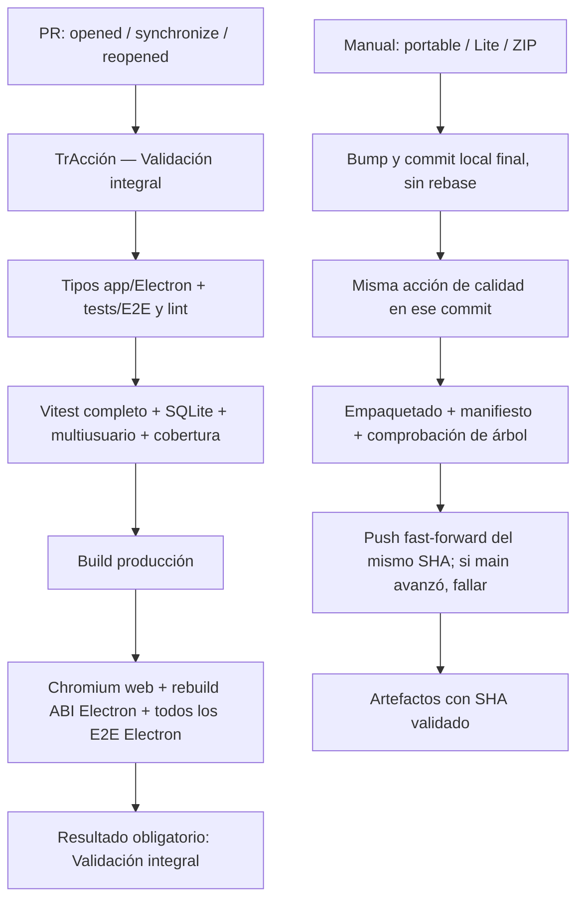

# Auditoría integral de tests y GitHub Actions

Fecha: 27 de octubre de 2026. Referencia: `df62803d`, antes de reorganizar CI.
Datos medidos en Linux, Node 22.13.1; Windows/SMB y GitHub Actions requieren
validación externa. No se han modificado reglas de negocio ni esquemas.

## A. Situación actual

Hay **210 archivos de pruebas**: 205 descubiertos por Vitest, un archivo de
versionado `.test.mjs` fuera de su selección y cuatro specs Playwright (tres
Electron y uno web). El inventario [por archivo](TEST_INVENTORY.md) registra
comportamientos, dependencias, ejecución anterior, clasificación y coste medido.
Vitest informa 477 suites (incluyen `describe` anidados): no son 477 archivos.

Referencia ejecutada: **1.188 tests, 1.181 pasan, 7 fallan, 0 pendientes**;
88,95 s de tiempo transcurrido, sin cobertura. Este tiempo se midió durante otras
comprobaciones y no constituye un benchmark aislado. Los siete fallos pertenecen
a los dos archivos de CoordinationPointEditor: `change` y `toHaveValue` se aplican
a un `div contentEditable`, tras sustituirse el textarea. Son tests desactualizados,
no evidencia de un defecto de sincronización. Tipos de aplicación/Electron,
tipos de tests, lint sin advertencias y build pasan en la referencia.
El build Vite indica 8,80 s y avisa de chunks grandes; no es un fallo.

No existía proveedor de cobertura ni umbrales. Se incorpora V8 compatible con
Vitest 2.1.9. Los porcentajes y tiempos adicionales se registrarán al completar
las ejecuciones comparables; no se deducen del número de tests. Cobertura de
líneas/ramas/funciones no acredita por sí sola protección de comportamientos.

### Los siete workflows

| Workflow | Eventos anteriores | Comprobaciones / problemas |
|---|---|---|
| tests-completos.yml | push todas las ramas, PR todas, manual | Tipos tests, lint, Vitest, build, rebuild Electron, solo dos specs Electron. Una PR recibe push + PR; sin cancelación. |
| tests-ci.yml | manual | Repite tipos tests, lint, Vitest, build; omite UI. |
| Ui-test.yml | manual | Instala, reconstruye y ejecuta todos los specs Electron; limpieza de caché contraproducente. |
| multiusuario-test.yml | manual | Diez archivos ya incluidos en Vitest; selección incompleta de concurrencia (por ejemplo licencias). No añade protección exclusiva. |
| build-windows.yml | manual | Lint, Vitest, build; omite tipos tests/UI; bump después de build y rebase después de empaquetar. |
| build-windows-lite.yml | manual | Solo build; sin lint/tests/UI. Mismo distribuidor con garantías inferiores. |
| build-windows-zip.yml | manual | Lint, Vitest, bump, build; sin tipos tests/UI; rebase posterior al paquete. |

Todos fijan Node con `.nvmrc` (22.13.1), pero varias claves de caché codifican
la versión y algunas dependen de package.json en lugar del lock. No hay
`continue-on-error`, pero eso no compensa las comprobaciones ausentes. Cada
workflow instala por separado; `npm ci` ya ejecuta scripts nativos y varias rutas
reconstruyen better-sqlite3 otra vez. Ningún job depende de una validación completa
antes de distribuir. El rebase posterior puede anunciar un commit que no es el
árbol empaquetado. La API de protección de main respondió `Forbidden`: no se ha
verificado ni cambiado ninguna regla remota.

## B. Cobertura funcional y fiabilidad

| Área | Protección existente que se conserva | Riesgo residual / actuación |
|---|---|---|
| SQLite, migraciones, persistencia | Repositorios SQL reales, OCC, lotes atómicos, triggers que fuerzan rollback, audit/identity/migrations | Añadir contención real entre conexiones y rechazo de schema futuro sin alterar datos. |
| Red y recuperación | externalDataSync recovery/multiuser, health monitor, connectivity, strict writes, lockManager network | Mocks y filesystem local no acreditan pérdida de SMB durante fsync ni cambio cable/Wi-Fi. Requiere laboratorio Windows/SMB. |
| Multiusuario | recordLocks SQL, orquestación mock, OCC por módulo, sincronización de stores y dos instancias Electron | Son capas complementarias. El E2E depende de acabar antes del polling de 12 s; sustituir la carrera por suspensión controlada del renderer B. |
| Backup/restauración | validación de backup, localBackupService, rollback y conservación de copia si rollback falla | Mantener fallos de activación y rechazo de copias. Corte físico durante reemplazo no acreditado. |
| Ticket Restaurante | mensual frente a cotización, deuda/hojas de gasto, ausencias/solapes, manutenciones, calendario, importación atómica, histórico de altas/bajas, año | No asumir cobertura de pedidos registrados/movimientos posteriores/exclusiones solo por probar el motor mensual. Falta recorrido integrado de cierre mensual + corrección posterior + exportación histórica. Prioridad alta. |
| Excel | parser XLSX real, delimitados, Huelgas layout real/exportaciones, backup con retry, escape de fórmulas, importPeople/duplicados | Falta roundtrip completo de todos los módulos, exportación parcial por error IPC y validación manual Excel instalado. |
| Cambios sin guardar | dirtyEditors, drafts recuperables, context switch safety, editores Coordinación y modales | Reparar siete interacciones obsoletas conservando conflicto, convergencia, recarga y desmontaje. Falta cierre nativo completo con varios editores. |
| Tareas | dominio, filtros/estados, notificaciones, repositorio, batches, readFailure/refresh, E2E creación/reinicio | Conservar tanto guardado SQL como visibilidad UI; no son duplicados. |
| Coordinación | invariantes/store, snapshots, reuniones, eliminación, editor/conflictos, OCC | hardening añade condiciones distintas: no refundir por nombre. |
| Comité/Paritaria | shared sessions, SQL sesiones, fases/validación/orden y Word summaries | Componentes compartidos protegen ambos; faltan recorridos UI completos de acta final e histórico. |
| Actas | tipos/actas SQL, store, dominio y modal Electron | Falta exportación/edición multiusuario E2E específica. |
| Huelgas | imports reales, circuitos, asignaciones, resultados, cierre, templates, exportación | Muchas fixtures del mismo módulo no son redundancia: formatos y condiciones distintas. |
| Teletrabajo/licencias | dominios, calendario/cobertura, exportación Dirección, stores/persistencia, SQL y concurrencia | Falta E2E aprobación/rechazo y límites entre años con persistencia. |
| Actividades externas/Criterios/Plantilla | vinculograma, reglas dominio, stores OCC, repositorios, employee master/traducciones | Falta flujo UI multiusuario transversal; conservar pruebas por capa. |
| Presupuestos/Lotería/Sorteos/configuración | cálculo/matching/import, persistencia/OCC, integridad catálogos | Mantener validaciones no triviales; un smoke de navegación no las sustituye. |
| Actualizador | appUpdate, progressWindow, AppUpdateChecker y versionado | Añadir al descubrimiento los 3 tests de release-version. Windows real, permisos/antivirus e instalación entre versiones siguen pendientes. |

No se detectaron tests `skip`, `todo` u `only` explícitos en el inventario inicial.
Los tests de locks usan esperas reales cortas: INVESTIGAR su estabilidad en CI;
no retirar ni relajar aserciones para acelerar. Pruebas que solo comprueban
delegaciones/forma se mantienen cuando protegen contratos IPC/SQL; no se ha
demostrado equivalencia suficiente para eliminarlas.

## C. Propuesta y decisiones previas a modificar CI

* **MANTENER** las 205 fuentes Vitest y los cuatro specs Playwright.
* **REFORZAR** siete tests del editor visual, fixture SQLite de Ticket, smoke web
  obsoleto, descubrimiento de scripts y aislamiento de proyectos Playwright.
* **INCORPORAR** tests deterministas de contención SQLite con timeout cero,
  recuperación tras liberar el bloqueo, rechazo de schema futuro y evidencia
  comparable de cobertura V8 incluyendo módulos nunca importados.
* **REFUNDIR** la configuración de calidad en una acción local compartida; los
  distribuidores ejecutarán esa misma acción sobre su commit final.
* **ELIMINAR** únicamente tres workflows manuales de tests redundantes:
  tests-ci, Ui-test y multiusuario-test. Equivalencia: tipos/lint/build/Vitest
  completos y todos los specs Electron en la acción oficial. **Cero tests
  eliminados.**
* **INVESTIGAR** SMB real, carrera de polling E2E, Excel/Outlook reales y
  restricciones de protección de ramas; documentar lo no ejecutado.

## D. Arquitectura objetivo

Solo `pull_request` dispara automáticamente la batería: no hay duplicado por
push. Cancelación de ejecuciones antiguas de la misma PR; distribución manual
serializada y sin cancelación de la ejecución activa. Un job Windows mantiene
ABI/orden explícitos: Vitest bajo Node **antes** del rebuild a Electron. Se
prioriza el sistema de producción y evita repetir instalación/build entre jobs.
Un build fallido de cualquier comprobación impide empaquetar/distribuir. Sin
consultar estados de otras ejecuciones ni aceptar el estado de otro commit.
El SHA final se crea antes de validar, se empaqueta sin cambios de fuente y se
publica sin rebase. Lite conserva su entrada manual, pero no omite garantías.

El administrador debe exigir **Validación integral** para main, bloquear bypass
y exigir PR actualizada; para merge queue haría falta añadir `merge_group` y
probarlo antes de habilitar la cola. No se asegura que esas reglas estén activas.

## E. Impacto previsto (estimaciones, no mediciones de Actions)

Para cada actualización de una rama con PR abierta: de dos baterías automáticas
a una (**50 % menos ejecuciones completas por ese patrón**). No se afirma 50 %
menos tiempo de la batería: incorpora specs omitidos, web y cobertura. Las tres
rutas manuales de diagnóstico desaparecen sin retirar sus tests. Caché npm por
lock y eliminación de limpiezas/rebuilds Node innecesarios reducen descargas y
trabajo, sin cuantificar minutos Windows no observados. No se promete ahorro
en Lite: ahora valida lo mismo y será más lento por una razón de integridad.

## F. Riesgos y límites

El ABI de better-sqlite3 cambia al ejecutar electron:rebuild: para volver a
Vitest hay que hacer `npm rebuild better-sqlite3` con Node 22. No reutilizar
node_modules entre runtimes/OS. Cancelar una PR es seguro (solo temporales),
cancelar una distribución no lo es. Un push concurrente a main hace fallar el
distribuidor: exige repetir la validación, nunca rebase silencioso. Reglas que
prohíban pushes del bot pueden bloquear el contador; no deben relajarse sin
decisión administrativa. Las comprobaciones aquí no acreditan binarios Windows,
SMB real, GitHub Actions remoto ni restauración en una tarea nueva del entorno.

## Resultados de implementación

El registro Windows aportado para `7e103deb` confirma **209 archivos y
1.202 tests aprobados** en 413,97 s. La ejecución falló exclusivamente en esa
fase por cobertura de funciones **48,93 %**, inferior al suelo del 49 %;
no llegó a acreditar build ni E2E. Líneas: 41,05 %; ramas: 70,16 %.

Se incorporan ocho pruebas en dos archivos, sin cambiar código funcional,
excluir fuentes de cobertura ni rebajar umbrales:

- `src/shared/export/tableExport.workbook.test.ts`: XLSX real que se vuelve
  a abrir con ExcelJS para comprobar todas las filas, importes positivos y
  negativos, fechas entre años, texto multilínea y fórmulas tratadas como texto;
  selección vacía, límites de buffers y propagación de errores de Electron.
- `src/features/ticket-restaurante/components/ticketRestauranteExport.test.ts`:
  precio histórico y ausencias aplicadas al exportar un pedido mensual,
  columnas específicas de cotización, carga numéricamente ordenada sin mutar
  el cálculo, y rechazo de una generación fallida conservando los datos.

Tras la corrección, la batería local Node 22.13.1 ejecuta **211 archivos y
1.210 tests aprobados**. Cobertura: **41,41 % líneas**, **49,59 % funciones**,
**70,20 % ramas**. Se mantiene el mismo conjunto de fuentes y las 87.153 líneas
del denominador de la revisión actual. V8 descubre funciones/ramas adicionales
al ejercitar rutas antes no ejecutadas: sus denominadores cambian; las funciones
cubiertas aumentan de 1.984 a 2.022. Los porcentajes Windows anteriores y Linux
posteriores no son un benchmark idéntico de plataforma ni prueban el resultado
Windows del nuevo commit. CI deberá confirmar las fases restantes.

La observación previa de un fallo intermitente OCC en Linux sigue registrada
en la PR; esta corrección de exportación no modifica su lógica ni pretende
resolverla. Un resultado verde puntual no acredita estabilidad de esa prueba.
SMB real, binarios Windows y actualizaciones entre versiones siguen pendientes.

### Selector de guardado de calendarios Electron

El registro Windows de `0c8dc007` confirma que pasan tipos, lint, Vitest con
cobertura, build e interfaz web. Electron pasa 8 de 10 tests; los dos de Ticket
fallan porque `name: 'Guardar'` encuentra tanto «Guardar» como «Guardar cambios».
Se exige coincidencia exacta en los tres guardados del spec, incluidos ambos
usuarios. Se conservan las aserciones de persistencia y rechazo del conflicto;
no se usa `.first()`, no se omiten pruebas ni se cambia la aplicación.
